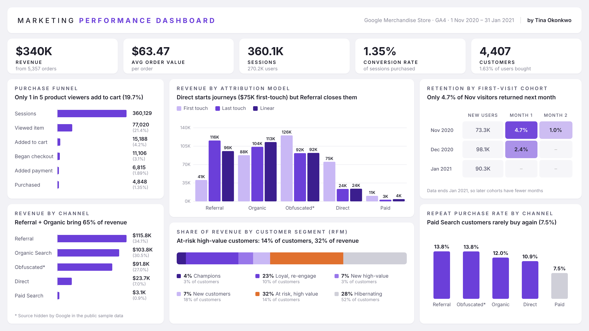

# Marketing Funnel & Channel Attribution Analysis (SQL / BigQuery)

Which marketing channels actually drive revenue, where customers drop off, and which channels bring the customers worth keeping. Analysed with SQL on Google's public GA4 e-commerce dataset.

## The data
- **Source:** `bigquery-public-data.ga4_obfuscated_sample_ecommerce` (Google Merchandise Store)
- **Period:** 1 Nov 2020 – 31 Jan 2021
- **Grain:** raw GA4 event export (nested `event_params`, `items` and `ecommerce` fields)
- **Scale:** 4.3M events · 360,129 sessions · 270,154 users · 5,357 orders · $340,017 revenue

## Business questions
1. What do traffic, customers and revenue look like for the period?
2. Where do users drop off in the purchase funnel, by device?
3. Which channels drive revenue, and which drive quality traffic?
4. How does channel credit change under first-touch, last-touch and linear attribution?
5. Do users come back after their first visit?
6. Who are the most valuable customers (RFM)?
7. Which acquisition channels bring the most valuable customers?

## Approach
The script builds five reusable temp tables (`base_events`, `sessions`, `purchases`, `users`, `customer_segments`) so the public dataset is scanned once, then answers each question with its own query. The results feed a Power BI dashboard.

**SQL techniques used:** `UNNEST` on nested GA4 parameters, CTEs, temp tables and a temp UDF for channel grouping, window functions (`NTILE`, `FIRST_VALUE`, `COUNT() OVER`, `SUM() OVER`), `ROLLUP`, `ARRAY_AGG ... ORDER BY ... LIMIT`, and time-bounded joins for linear attribution.

## Key findings
1. **Funnel:** the biggest drop is between **viewing a product and adding it to cart**. Only **19.7%** of sessions that view a product add to cart, and only **1.35%** of all sessions end in a purchase. The drop is almost identical on mobile (19.9%) and desktop (19.6%), so it's a product page or offer problem, not a mobile UX problem.
2. **Channels:** **Organic Search** brings the most sessions (96,222), but **Referral** earns the most revenue ($115.8K, 34% of total) and the highest revenue per session of any major channel ($1.80 vs $1.08 for Organic).
3. **Attribution:** **Direct** earns **3.2× more credit under first touch** ($75.4K) than last touch ($23.7K). It opens customer journeys that last-click reporting undervalues. **Referral** is the opposite: it closes sales, earning 2.8× more under last touch ($115.8K vs $40.7K).
4. **Retention:** only **4.7%** of the November cohort came back in December, and 1.0% in January. The December cohort's next-month return was even lower, at 2.4%.
5. **Customers:** **"At risk, high value" customers are 13.9% of customers but generate 31.9% of revenue.** They spent $178 on average but haven't ordered in about 61 days.
6. **Customer quality:** customers first acquired through **Referral** spend the most ($81 on average) and come back most often (**13.8%** repeat rate). **Paid Search** customers have the lowest repeat rate (**7.5%**).

## Recommendations
1. **Fix the product page before buying more traffic.** Four out of five product viewers never add to cart, on every device. Test clearer pricing and shipping costs, stronger product images and reviews, and a more visible add-to-cart button.
2. **Don't judge channels on last-click alone.** Last-click reporting would cut Direct and Paid Search, but they start a large share of journeys. Use first-touch or linear credit when setting budgets, and keep investing in Referral partnerships, which both close sales and bring the most loyal customers.
3. **Launch a win-back campaign for the 611 "at risk, high value" customers.** They hold almost a third of revenue. A targeted email or offer around day 45–60 after their last purchase would protect it.
4. **Fix tracking gaps.** About a quarter of sessions have no traffic source recorded, so tighten UTM tagging to make channel reporting more reliable.

## Limitations
- The dataset is Google's **obfuscated sample**. Some sources are hidden (shown as "Obfuscated"), and about 26% of sessions have no source recorded.
- Three months of data limits how far retention can be followed (two months for the November cohort).

## How to run
1. Open the [BigQuery console](https://console.cloud.google.com/bigquery). The free sandbox works.
2. Paste `marketing_analytics_ga4.sql` and run the whole script.
3. Each query's result opens in its own tab under the script results.

## Dashboard
Built in Power BI from the query results (`dashboard.png` above). It covers KPIs, the purchase funnel, revenue by channel, attribution models, retention cohorts, RFM segments and repeat purchase rate by channel.

## Author
**Tina Okonkwo**, Data & Digital Technology Professional · [LinkedIn](#) · [Portfolio](#)
